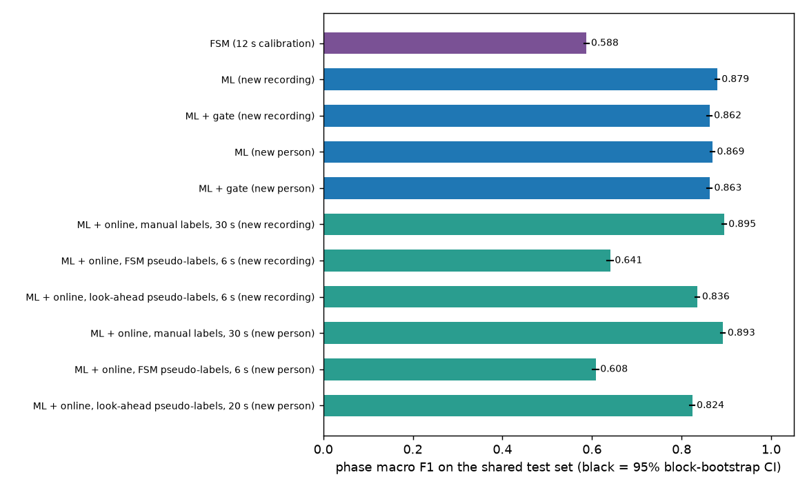
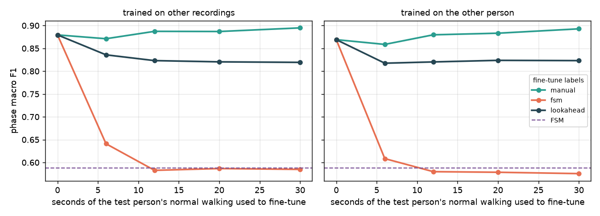

# SAKER gait detection: FSM vs ML vs ML + online learning

Ground truth: every stride in the 7 real recordings marked **by eye** (heel strike, push-off, toe-off, mid-swing) on plots of the shank/thigh gyro and shank acceleration. No detection code placed any mark.
Test set (identical for every method): in each recording everything after **walk_normal start + 30 s**: 212,435 labelled samples, 1,394 sure heel strikes.

## Headline

- Best phase accuracy: **ML + online, manual labels, 30 s (new recording)** (macro F1 0.895).
- Best heel-strike detection (the motor trigger): **FSM (12 s calibration)** (HS F1 0.987).
- FSM: macro F1 0.588, finds 98.7% of heel strikes with 1.2 false ones per 100 strides, median timing -30 ms.
- ML (new recording): macro F1 0.879; ML (new person): 0.869.
- Best ML + online (new recording): ML + online, manual labels, 30 s (new recording), macro F1 0.895.

## 1. Main comparison

| method | macro F1 [95% CI] | 3-phase F1 | HS found | HS false / 100 strides | HS timing (median) | HS \|err\| P90 | HS found ±300 ms | TO found | MS found | false HS while standing |
|---|---|---|---|---|---|---|---|---|---|---|
| FSM (12 s calibration) | 0.588 [0.582–0.593] | 0.698 | 98.7% | 1.2 | -30 ms | 60 ms | 98.9% | 27.0% | 98.9% | 2 |
| ML (new recording) | 0.879 [0.875–0.884] | 0.912 | 97.6% | 36.6 | +10 ms | 50 ms | 100.0% | 99.8% | 99.8% | 6 |
| ML + gate (new recording) | 0.862 [0.857–0.868] | 0.898 | 89.9% | 18.3 | +20 ms | 50 ms | 99.9% | 99.5% | 99.1% | 5 |
| ML (new person) | 0.869 [0.864–0.874] | 0.917 | 98.0% | 32.3 | +10 ms | 30 ms | 99.9% | 100.0% | 97.8% | 27 |
| ML + gate (new person) | 0.863 [0.856–0.868] | 0.912 | 95.3% | 13.1 | +10 ms | 40 ms | 99.9% | 99.9% | 96.9% | 24 |
| ML + online, manual labels, 30 s (new recording) | 0.895 [0.890–0.900] | 0.932 | 99.9% | 20.5 | +10 ms | 40 ms | 99.9% | 100.0% | 99.7% | 6 |
| ML + online, FSM pseudo-labels, 6 s (new recording) | 0.641 [0.634–0.648] | 0.735 | 97.8% | 42.7 | -10 ms | 70 ms | 99.9% | 57.2% | 88.2% | 1 |
| ML + online, look-ahead pseudo-labels, 6 s (new recording) | 0.836 [0.831–0.840] | 0.913 | 97.8% | 36.4 | +10 ms | 57 ms | 100.0% | 99.8% | 97.9% | 6 |
| ML + online, manual labels, 30 s (new person) | 0.893 [0.888–0.897] | 0.935 | 99.9% | 7.5 | +10 ms | 30 ms | 99.9% | 100.0% | 99.7% | 21 |
| ML + online, FSM pseudo-labels, 6 s (new person) | 0.608 [0.601–0.616] | 0.709 | 93.6% | 30.9 | -20 ms | 60 ms | 99.6% | 44.5% | 84.1% | 15 |
| ML + online, look-ahead pseudo-labels, 20 s (new person) | 0.824 [0.819–0.828] | 0.924 | 99.7% | 33.8 | +0 ms | 40 ms | 99.9% | 99.9% | 99.3% | 19 |

"found" = matched one-to-one within ±150 ms of a manual mark of the same type; timing = detection minus manual mark (+ = late). The ±300 ms column separates *late* from *missed*. 3-phase F1 merges STANCE and PRE_SWING, so it does not depend on where push-off is put (the softest landmark).

## 1b. Different ML models and sensors (same features, same test set)

| model (same features) | trained on | macro F1 | HS found | HS false / 100 | HS timing | TO found | macro F1 with gate | HS false / 100 with gate |
|---|---|---|---|---|---|---|---|---|
| MLP (both IMUs) | other recordings | 0.879 | 97.6% | 36.6 | +10 ms | 99.8% | 0.862 | 18.3 |
| Logistic regression | other recordings | 0.842 | 91.3% | 23.8 | +30 ms | 99.4% | 0.827 | 20.4 |
| Linear SVM | other recordings | 0.854 | 98.6% | 24.5 | +20 ms | 99.8% | 0.836 | 17.2 |
| Random forest | other recordings | 0.901 | 98.9% | 22.2 | +10 ms | 99.7% | 0.886 | 17.4 |
| Gradient boosting | other recordings | 0.897 | 100.0% | 17.0 | +10 ms | 99.6% | 0.888 | 12.8 |
| MLP, shank IMU only | other recordings | 0.894 | 96.1% | 27.6 | +10 ms | 100.0% | 0.880 | 18.9 |
| MLP, thigh IMU only | other recordings | 0.704 | 88.0% | 65.9 | +20 ms | 89.9% | 0.691 | 48.5 |
| MLP (both IMUs) | other person | 0.869 | 98.0% | 32.3 | +10 ms | 100.0% | 0.863 | 13.1 |
| Logistic regression | other person | 0.825 | 91.6% | 40.9 | +20 ms | 98.9% | 0.827 | 24.6 |
| Linear SVM | other person | 0.846 | 91.5% | 44.3 | +10 ms | 99.8% | 0.840 | 24.2 |
| Random forest | other person | 0.901 | 98.5% | 24.7 | +10 ms | 100.0% | 0.886 | 19.4 |
| Gradient boosting | other person | 0.863 | 99.6% | 15.3 | +10 ms | 97.3% | 0.854 | 9.4 |
| MLP, shank IMU only | other person | 0.862 | 95.1% | 76.7 | +10 ms | 100.0% | 0.847 | 38.7 |
| MLP, thigh IMU only | other person | 0.628 | 81.3% | 141.0 | +0 ms | 92.1% | 0.638 | 56.9 |

"gate" = the model's phases may only move forward round the gait cycle, and a heel strike needs a swing since the last one and ≥ 300 ms gap (like the FSM).

## 2. By task (macro F1 / heel strikes found)

| method | walk_normal | walk_slow | walk_fast | turns | stop_go | stand |
|---|---|---|---|---|---|---|
| FSM (12 s calibration) | 0.57 / HS 99.2% | 0.56 / HS 97.5% | 0.59 / HS 99.7% | 0.59 / HS 100.0% | 0.58 / HS 96.4% | 0.64 / HS 88.2% |
| ML (new recording) | 0.89 / HS 98.5% | 0.89 / HS 99.4% | 0.86 / HS 93.7% | 0.87 / HS 98.9% | 0.88 / HS 98.5% | 0.90 / HS 100.0% |
| ML + gate (new recording) | 0.88 / HS 90.3% | 0.86 / HS 88.7% | 0.85 / HS 91.7% | 0.84 / HS 86.7% | 0.85 / HS 89.8% | 0.86 / HS 100.0% |
| ML (new person) | 0.87 / HS 95.4% | 0.88 / HS 99.7% | 0.84 / HS 98.0% | 0.88 / HS 100.0% | 0.87 / HS 98.5% | 0.83 / HS 100.0% |
| ML + gate (new person) | 0.87 / HS 93.1% | 0.87 / HS 92.8% | 0.84 / HS 98.3% | 0.87 / HS 98.3% | 0.86 / HS 94.9% | 0.79 / HS 100.0% |
| ML + online, manual labels, 30 s (new recording) | 0.91 / HS 100.0% | 0.90 / HS 100.0% | 0.87 / HS 99.7% | 0.90 / HS 100.0% | 0.87 / HS 100.0% | 0.89 / HS 100.0% |

## 3. Online learning: how much does fine-tuning on the first x seconds help?

| trained on | fine-tune labels | 0 s | 6 s | 12 s | 20 s | 30 s |
|---|---|---|---|---|---|---|
| other recordings | manual | 0.879 (HS F1 0.83) | 0.871 (HS F1 0.84) | 0.887 (HS F1 0.88) | 0.887 (HS F1 0.90) | 0.895 (HS F1 0.91) |
| other recordings | fsm | 0.879 (HS F1 0.83) | 0.641 (HS F1 0.81) | 0.583 (HS F1 0.87) | 0.587 (HS F1 0.89) | 0.585 (HS F1 0.89) |
| other recordings | lookahead | 0.879 (HS F1 0.83) | 0.836 (HS F1 0.84) | 0.823 (HS F1 0.85) | 0.820 (HS F1 0.83) | 0.819 (HS F1 0.87) |
| other person | manual | 0.869 (HS F1 0.85) | 0.859 (HS F1 0.89) | 0.880 (HS F1 0.95) | 0.883 (HS F1 0.96) | 0.893 (HS F1 0.96) |
| other person | fsm | 0.869 (HS F1 0.85) | 0.608 (HS F1 0.83) | 0.580 (HS F1 0.88) | 0.579 (HS F1 0.88) | 0.576 (HS F1 0.89) |
| other person | lookahead | 0.869 (HS F1 0.85) | 0.817 (HS F1 0.86) | 0.820 (HS F1 0.82) | 0.824 (HS F1 0.85) | 0.823 (HS F1 0.86) |

`manual` = fine-tuned on the by-eye labels of those seconds (best case, needs a human). `fsm` = on the board FSM's own phases (what the board could do alone). `lookahead` = on an offline shank-gyro labeller run over the buffered seconds (also possible on the board).

## 4. Per recording (macro F1)

| method | YR1 | YR2 | AL1 | AL2 | YL1 | YL2 | YL3 |
|---|---|---|---|---|---|---|---|
| FSM (12 s calibration) | 0.56 | 0.57 | 0.61 | 0.61 | 0.59 | 0.56 | 0.58 |
| ML (new recording) | 0.84 | 0.79 | 0.91 | 0.90 | 0.92 | 0.93 | 0.87 |
| ML + gate (new recording) | 0.85 | 0.69 | 0.89 | 0.90 | 0.91 | 0.92 | 0.87 |
| ML (new person) | 0.87 | 0.78 | 0.89 | 0.90 | 0.85 | 0.87 | 0.89 |

## 5. How good is the ground truth?

- **changes the reviewer made to the annotator's marks (not an independent agreement: the reviewer edits the annotator's file)** (4 chunks; per-sample phase agreement 100.0%): HS: 136/136 matched, median |Δt| 0 ms (P90 0 ms); PO: 130/130 matched, median |Δt| 0 ms (P90 0 ms); TO: 137/137 matched, median |Δt| 0 ms (P90 0 ms); MS: 135/135 matched, median |Δt| 0 ms (P90 0 ms)

## 6. Method

- **Same test set for all methods.** The setup window (opening stand + first 30 s of walk_normal) is never scored. The FSM calibrates on its first 12 s (the board's `analyseWalk`), and ML + online fine-tunes on its first x ≤ 30 s. Plain ML never sees the test recording.
- **FSM** = the board's `GaitFsm.h`, compiled from `SAKER_Sender`, fed the same 100 Hz stream (Wi-Fi gaps filled by straight lines; the board itself never has gaps).
- **ML** = small MLP (≈3k weights) on causal features (current + past 1 s of shank/thigh rate, shank |acc|, thigh |gyro|), debounced phase changes → events. Trained leave-one-recording-out and leave-one-person-out; hyper-parameters picked on an inner validation recording, never the test one.
- **ML + online** = the same MLP fine-tuned (all layers, Adam, protocol chosen on the inner validation recording).
- Bootstrap: 10 s blocks resampled within each recording, 2000 draws, paired across methods.

## 7. Caveats

- 2 people, 7 recordings, one session per person and leg; Amjad wore slippers.
- Truth is by-eye on IMU traces, with no video or foot switch. Push-off is the least certain mark, and the FSM's push-off threshold (60% of the dip) sits later than the by-eye push-off by design.
- ~7-10% of samples are lost over Wi-Fi; events hidden by a gap are marked unclear and not scored.
- Annotation: 36 chunks by Opus agents; the last 14 completed by Sonnet at low effort (mostly verifying earlier Opus drafts). 1 chunk fully reviewed, 3 reviews stopped part-way; blind doubles cancelled to save credits.

## 8. Interpretation (written from the final run; numbers are in tables 1–3)

### FSM (board GaitFsm, 12 s calibration)

- **Heel strike, the only event that fires the motor, is excellent.**
  - It finds 98.7% of heel strikes, with 1.2 false ones per 100 strides and only 2 during standing.
  - It fires a median 30 ms early: it triggers when the shank rate drops below `heelStrike` just after the zero crossing, slightly before the impact. The P90 error is 60 ms.
  - Its HS F1 (0.987) is the best of every method tested.
- **The phases are poor (macro F1 0.59)** because its thresholds fire late by design:
  - toe-off is a median 140 ms late (it waits for the shank to rise past swingEnter), so only 27% land within ±150 ms, though 99% land within ±300 ms;
  - mid-swing is 60 ms late (it waits for the drop to 80% of the peak);
  - push-off is 90–200 ms late (it waits for 60% of the dip).
- So the FSM is late, not lost. It cuts the stride at the wrong moments, but it still produces one clean stride per stride.

### ML (MLP, 3k weights, trained on other recordings)

- **The phases are far better (macro F1 0.88).** Every event is a median 10 ms from the manual mark, and toe-off and mid-swing are found ≥ 99.8% of the time.
- **It generalises to a new person**, at least with 2 people: macro F1 drops only from 0.879 (new recording) to 0.869 (new person).
- **But it fires many false heel strikes: about 32–37 per 100 strides.** The phase output flickers around stance/terminal swing, and each flicker becomes an extra heel-strike event. Trained on the other person, it also gave 27 false heel strikes while standing.
- As a motor trigger it's worse than the FSM. That would need a refractory period or an FSM-style "one heel strike per stride" gate on top.

### ML + online learning (fine-tune on the first x s of normal walking)

- **With manual labels it helps, and it helps most on a new person.**
  - Fine-tuning on 30 s raises macro F1 to 0.893–0.895.
  - False heel strikes fall from 32 to 7.5 per 100 strides (new person) and from 37 to 20.5 (new recording).
  - Even 12 s gives most of the gain.
  - But someone has to label those seconds, so this is an upper bound, not something the board can do by itself.
- **The two label sources the board could use by itself don't help:**
  - **FSM pseudo-labels make it much worse** (macro F1 about 0.58–0.64). The model learns the FSM's lag: its toe-offs and push-offs move late like the FSM's.
  - **Look-ahead pseudo-labels** (the offline shank-gyro rule run on the buffer) **are slightly worse than no fine-tuning** (0.82–0.84 vs 0.87–0.88). That rule puts push-off at "12% of the stride before toe-off", which disagrees with where push-off actually is (median +110 ms vs the manual marks), so the model gets pulled away from the truth.
- **Conclusion: online learning is only worth it if the labels for the fine-tuning seconds are good.** Self-labelling with the FSM or the simple rule doesn't buy anything here.

### Different models and sensors (table 1b)

- **Tree ensembles are the best ML models.** All six models get the same features and the same test set.
  - Random forest: macro F1 0.901 on both a new recording and a new person.
  - Gradient boosting: 0.897 on a new recording, 0.863 on a new person.
  - Both beat the MLP (0.879 / 0.869), and the linear models trail (0.84–0.85).
  - Gradient boosting has the fewest false heel strikes of any ML model: 17 per 100 strides, 9.4 with the gate on a new person.
- **The shank carries the signal.**
  - An MLP on the shank IMU alone (0.894) does as well as both IMUs.
  - The thigh alone is poor (0.63–0.70), with many false heel strikes.
  - This matches the FSM's design, which also works mainly from the shank.
- **The "one heel strike per stride" gate** only lets phases move forward round the cycle, and requires a swing and ≥ 300 ms between heel strikes.
  - It halves false heel strikes: MLP 36.6 → 18.3, gradient boosting 17.0 → 12.8.
  - It costs 0.01–0.02 macro F1 and, for some models, some recall.
  - Even the best gated ML (9.4 per 100) is still about 8× noisier than the FSM (1.2 per 100).

### What to use

- **Motor trigger (heel strike): keep the FSM.** It has the most reliable heel strike with the fewest false triggers. Firing about 30 ms early is harmless, and arguably helpful, given the motor's 1.5 s move.
- **If you need the phases themselves** (assistance timed inside swing, or swing/stance percentages): use the ML model, but take heel strike from the FSM, or gate the ML heel strikes (refractory period ≥ 300 ms, only allowed after a swing).
- **Online learning** is worth revisiting only with a better self-labeller, or a short labelled calibration walk per user. With FSM labels it actively hurts.

### Caveats specific to these numbers

- **Ground-truth quality was measured less than planned.** One chunk got a full independent review (155 marks, none moved more than 15 ms). Three more reviews were stopped part-way to save credits, so they show little change, and the blind double annotations were cancelled.
- **The by-eye marks were checked against the textbook shank-gyro rule:** toe-off and mid-swing match it with median 0 ms and P90 10 ms, and heel strike with median −10 ms and P90 70 ms (the manual heel strike is the impact onset, the rule's is the dip). The clear landmarks therefore agree with the standard definition. Push-off has no rule equivalent and is the softest mark: most push-off marks are flagged unsure, and only sure marks are scored as events.
- **The last 14 chunks were completed by Sonnet at low effort.** Most of their marks came from earlier Opus attempts, and Sonnet only spot-checked them.
