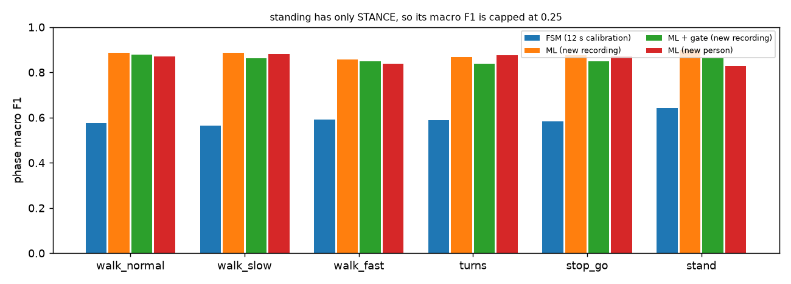

# SAKER gait detection: FSM vs ML vs ML + online learning

Ground truth: every stride in the 7 real recordings marked **by eye** (heel strike, push-off, toe-off, mid-swing) on plots of the shank/thigh gyro and shank acceleration. No detection code placed any mark.
Test set (identical for every method): in each recording everything after **walk_normal start + 30 s**: 212,435 labelled samples, 1,394 sure heel strikes.

## Headline

- Best phase accuracy: **ML + online, manual labels, 30 s (new recording)** (macro F1 0.895).
- Best heel-strike detection (the motor trigger): **FSM (12 s calibration)** (HS F1 0.987).
- FSM: macro F1 0.588, finds 98.7% of heel strikes with 1.2 false ones per 100 strides, median timing -30 ms.
- ML (new recording): macro F1 0.879; ML (new person): 0.869.
- Best ML + online (new recording): ML + online, manual labels, 30 s (new recording), macro F1 0.895.

## 1. Main comparison

| method | macro F1 [95% CI] | 3-phase F1 | HS found | HS false / 100 strides | HS timing (median) | HS \|err\| P90 | HS found ±300 ms | TO found | MS found | false HS while standing |
|---|---|---|---|---|---|---|---|---|---|---|
| FSM (12 s calibration) | 0.588 [0.582–0.593] | 0.698 | 98.7% | 1.2 | -30 ms | 60 ms | 98.9% | 27.0% | 98.9% | 2 |
| ML (new recording) | 0.879 [0.875–0.884] | 0.912 | 97.6% | 36.6 | +10 ms | 50 ms | 100.0% | 99.8% | 99.8% | 6 |
| ML + gate (new recording) | 0.862 [0.857–0.868] | 0.898 | 89.9% | 18.3 | +20 ms | 50 ms | 99.9% | 99.5% | 99.1% | 5 |
| ML (new person) | 0.869 [0.864–0.874] | 0.917 | 98.0% | 32.3 | +10 ms | 30 ms | 99.9% | 100.0% | 97.8% | 27 |
| ML + gate (new person) | 0.863 [0.856–0.868] | 0.912 | 95.3% | 13.1 | +10 ms | 40 ms | 99.9% | 99.9% | 96.9% | 24 |
| ML + online, manual labels, 30 s (new recording) | 0.895 [0.890–0.900] | 0.932 | 99.9% | 20.5 | +10 ms | 40 ms | 99.9% | 100.0% | 99.7% | 6 |
| ML + online, FSM pseudo-labels, 6 s (new recording) | 0.641 [0.634–0.648] | 0.735 | 97.8% | 42.7 | -10 ms | 70 ms | 99.9% | 57.2% | 88.2% | 1 |
| ML + online, look-ahead pseudo-labels, 6 s (new recording) | 0.836 [0.831–0.840] | 0.913 | 97.8% | 36.4 | +10 ms | 57 ms | 100.0% | 99.8% | 97.9% | 6 |
| ML + online, manual labels, 30 s (new person) | 0.893 [0.888–0.897] | 0.935 | 99.9% | 7.5 | +10 ms | 30 ms | 99.9% | 100.0% | 99.7% | 21 |
| ML + online, FSM pseudo-labels, 6 s (new person) | 0.608 [0.601–0.616] | 0.709 | 93.6% | 30.9 | -20 ms | 60 ms | 99.6% | 44.5% | 84.1% | 15 |
| ML + online, look-ahead pseudo-labels, 20 s (new person) | 0.824 [0.819–0.828] | 0.924 | 99.7% | 33.8 | +0 ms | 40 ms | 99.9% | 99.9% | 99.3% | 19 |

"found" = matched one-to-one within ±150 ms of a manual mark of the same type; timing = detection minus manual mark (+ = late). The ±300 ms column separates *late* from *missed*. 3-phase F1 merges STANCE and PRE_SWING, so it does not depend on where push-off is put (the softest landmark).

## 1b. Different ML models and sensors (same features, same test set)

| model (same features) | trained on | macro F1 | HS found | HS false / 100 | HS timing | TO found | macro F1 with gate | HS false / 100 with gate |
|---|---|---|---|---|---|---|---|---|
| MLP (both IMUs) | other recordings | 0.879 | 97.6% | 36.6 | +10 ms | 99.8% | 0.862 | 18.3 |
| Logistic regression | other recordings | 0.842 | 91.3% | 23.8 | +30 ms | 99.4% | 0.827 | 20.4 |
| Linear SVM | other recordings | 0.854 | 98.6% | 24.5 | +20 ms | 99.8% | 0.836 | 17.2 |
| Random forest | other recordings | 0.901 | 98.9% | 22.2 | +10 ms | 99.7% | 0.886 | 17.4 |
| Gradient boosting | other recordings | 0.897 | 100.0% | 17.0 | +10 ms | 99.6% | 0.888 | 12.8 |
| MLP, shank IMU only | other recordings | 0.894 | 96.1% | 27.6 | +10 ms | 100.0% | 0.880 | 18.9 |
| MLP, thigh IMU only | other recordings | 0.704 | 88.0% | 65.9 | +20 ms | 89.9% | 0.691 | 48.5 |
| MLP (both IMUs) | other person | 0.869 | 98.0% | 32.3 | +10 ms | 100.0% | 0.863 | 13.1 |
| Logistic regression | other person | 0.825 | 91.6% | 40.9 | +20 ms | 98.9% | 0.827 | 24.6 |
| Linear SVM | other person | 0.846 | 91.5% | 44.3 | +10 ms | 99.8% | 0.840 | 24.2 |
| Random forest | other person | 0.901 | 98.5% | 24.7 | +10 ms | 100.0% | 0.886 | 19.4 |
| Gradient boosting | other person | 0.863 | 99.6% | 15.3 | +10 ms | 97.3% | 0.854 | 9.4 |
| MLP, shank IMU only | other person | 0.862 | 95.1% | 76.7 | +10 ms | 100.0% | 0.847 | 38.7 |
| MLP, thigh IMU only | other person | 0.628 | 81.3% | 141.0 | +0 ms | 92.1% | 0.638 | 56.9 |

"gate" = the model's phases may only move forward round the gait cycle, and a heel strike needs a swing since the last one and ≥ 300 ms gap (like the FSM).

## 2. By task (macro F1 / heel strikes found)

| method | walk_normal | walk_slow | walk_fast | turns | stop_go | stand |
|---|---|---|---|---|---|---|
| FSM (12 s calibration) | 0.57 / HS 99.2% | 0.56 / HS 97.5% | 0.59 / HS 99.7% | 0.59 / HS 100.0% | 0.58 / HS 96.4% | 0.64 / HS 88.2% |
| ML (new recording) | 0.89 / HS 98.5% | 0.89 / HS 99.4% | 0.86 / HS 93.7% | 0.87 / HS 98.9% | 0.88 / HS 98.5% | 0.90 / HS 100.0% |
| ML + gate (new recording) | 0.88 / HS 90.3% | 0.86 / HS 88.7% | 0.85 / HS 91.7% | 0.84 / HS 86.7% | 0.85 / HS 89.8% | 0.86 / HS 100.0% |
| ML (new person) | 0.87 / HS 95.4% | 0.88 / HS 99.7% | 0.84 / HS 98.0% | 0.88 / HS 100.0% | 0.87 / HS 98.5% | 0.83 / HS 100.0% |
| ML + gate (new person) | 0.87 / HS 93.1% | 0.87 / HS 92.8% | 0.84 / HS 98.3% | 0.87 / HS 98.3% | 0.86 / HS 94.9% | 0.79 / HS 100.0% |
| ML + online, manual labels, 30 s (new recording) | 0.91 / HS 100.0% | 0.90 / HS 100.0% | 0.87 / HS 99.7% | 0.90 / HS 100.0% | 0.87 / HS 100.0% | 0.89 / HS 100.0% |

## 3. Online learning: how much does fine-tuning on the first x seconds help?

| trained on | fine-tune labels | 0 s | 6 s | 12 s | 20 s | 30 s |
|---|---|---|---|---|---|---|
| other recordings | manual | 0.879 (HS F1 0.83) | 0.871 (HS F1 0.84) | 0.887 (HS F1 0.88) | 0.887 (HS F1 0.90) | 0.895 (HS F1 0.91) |
| other recordings | fsm | 0.879 (HS F1 0.83) | 0.641 (HS F1 0.81) | 0.583 (HS F1 0.87) | 0.587 (HS F1 0.89) | 0.585 (HS F1 0.89) |
| other recordings | lookahead | 0.879 (HS F1 0.83) | 0.836 (HS F1 0.84) | 0.823 (HS F1 0.85) | 0.820 (HS F1 0.83) | 0.819 (HS F1 0.87) |
| other person | manual | 0.869 (HS F1 0.85) | 0.859 (HS F1 0.89) | 0.880 (HS F1 0.95) | 0.883 (HS F1 0.96) | 0.893 (HS F1 0.96) |
| other person | fsm | 0.869 (HS F1 0.85) | 0.608 (HS F1 0.83) | 0.580 (HS F1 0.88) | 0.579 (HS F1 0.88) | 0.576 (HS F1 0.89) |
| other person | lookahead | 0.869 (HS F1 0.85) | 0.817 (HS F1 0.86) | 0.820 (HS F1 0.82) | 0.824 (HS F1 0.85) | 0.823 (HS F1 0.86) |

`manual` = fine-tuned on the by-eye labels of those seconds (best case, needs a human). `fsm` = on the board FSM's own phases (what the board could do alone). `lookahead` = on an offline shank-gyro labeller run over the buffered seconds (also possible on the board).

### 3b. Online learning for every model (phase macro F1)

| model | trained on | no fine-tune | hand labels 12 s | hand labels 30 s | best self-labelled (rule / FSM) | false HS/100: none → hand 30 s |
|---|---|---|---|---|---|---|
| MLP (both IMUs) | other recordings | 0.879 | 0.887 | 0.895 | 0.836 (lookahead, 6 s) | 36.6 → 20.5 |
| MLP, shank only | other recordings | 0.894 | 0.896 | 0.903 | 0.842 (lookahead, 6 s) | 27.6 → 10.3 |
| MLP, thigh only | other recordings | 0.704 | 0.742 | 0.774 | 0.713 (lookahead, 30 s) | 65.9 → 25.0 |
| Random forest | other recordings | 0.901 | 0.908 | 0.910 | 0.905 (lookahead, 30 s) | 22.2 → 5.7 |
| Gradient boosting | other recordings | 0.897 | 0.734 | 0.632 | 0.642 (lookahead, 12 s) | 17.0 → 155.2 |
| Linear SVM | other recordings | 0.854 | 0.862 | 0.873 | 0.824 (lookahead, 30 s) | 24.5 → 6.4 |
| Logistic regression | other recordings | 0.842 | 0.858 | 0.871 | 0.822 (lookahead, 12 s) | 23.8 → 5.7 |
| MLP (both IMUs) | other person | 0.869 | 0.880 | 0.893 | 0.824 (lookahead, 20 s) | 32.3 → 7.5 |
| MLP, shank only | other person | 0.862 | 0.889 | 0.896 | 0.834 (lookahead, 12 s) | 76.7 → 37.7 |
| MLP, thigh only | other person | 0.628 | 0.743 | 0.780 | 0.724 (lookahead, 20 s) | 141.0 → 46.6 |
| Random forest | other person | 0.901 | 0.911 | 0.915 | 0.901 (lookahead, 30 s) | 24.7 → 9.4 |
| Gradient boosting | other person | 0.863 | 0.700 | 0.673 | 0.685 (lookahead, 12 s) | 15.3 → 97.8 |
| Linear SVM | other person | 0.846 | 0.874 | 0.885 | 0.836 (lookahead, 30 s) | 44.3 → 8.0 |
| Logistic regression | other person | 0.825 | 0.853 | 0.870 | 0.815 (lookahead, 30 s) | 40.9 → 8.4 |

How each model is adapted: neural nets are fine-tuned by gradient steps; gradient boosting gets 50 more boosting rounds fitted to the new walker; random forest gets 50 more trees grown on the new walker; linear models are refit with the new walker's seconds weighted as much as all training data.

## 3e. Interpretability: what the models rely on

Permutation importance, leave one recording out: shuffle one group of inputs in the test recording and see how much phase macro F1 drops (mean over the 7 recordings, min–max in brackets).

| input group | features | random forest | gradient boosting | neural net |
|---|---|---|---|---|
| signal: shank rate | 23 | 0.624 [0.551–0.652] | 0.600 [0.541–0.645] | 0.531 [0.437–0.622] |
| signal: thigh rate | 23 | 0.006 [0.002–0.008] | 0.004 [-0.001–0.009] | 0.016 [0.008–0.038] |
| signal: shank acceleration | 15 | 0.007 [-0.045–0.022] | 0.021 [0.009–0.035] | 0.042 [-0.015–0.063] |
| signal: thigh rotation speed | 15 | 0.010 [0.003–0.017] | 0.013 [0.007–0.026] | 0.023 [0.014–0.037] |
| kind: value now | 4 | 0.010 [0.003–0.043] | 0.028 [0.010–0.105] | 0.026 [0.010–0.057] |
| kind: recent change | 32 | 0.177 [0.141–0.216] | 0.132 [0.101–0.161] | 0.171 [0.129–0.221] |
| kind: 200 ms window | 24 | 0.276 [0.242–0.299] | 0.284 [0.261–0.296] | 0.218 [0.171–0.260] |
| kind: 0.5-1 s window | 16 | 0.098 [0.078–0.120] | 0.082 [0.066–0.098] | 0.101 [0.053–0.169] |

Top features the random forest splits on (impurity importance, mean of 7 folds):

| rank | feature | kind | importance |
|---|---|---|---|
| 1 | `shank_sag_mean20` | 200 ms window | 0.0648 |
| 2 | `shank_sag_max20` | 200 ms window | 0.0632 |
| 3 | `shank_sag_since_max100` | 0.5-1 s window | 0.0569 |
| 4 | `shank_sag_d1` | recent change | 0.0526 |
| 5 | `shank_sag_d2` | recent change | 0.051 |
| 6 | `shank_sag_d8` | recent change | 0.0478 |
| 7 | `shank_sag_min20` | 200 ms window | 0.0472 |
| 8 | `shank_sag_d5` | recent change | 0.047 |
| 9 | `shank_sag_max50` | 0.5-1 s window | 0.0439 |
| 10 | `shank_sag_d3` | recent change | 0.0392 |
| 11 | `shank_sag` | value now | 0.0313 |
| 12 | `shank_sag_since_min20` | 200 ms window | 0.0306 |
| 13 | `shank_sag_d12` | recent change | 0.0305 |
| 14 | `shank_sag_since_max50` | 0.5-1 s window | 0.0248 |
| 15 | `shank_sag_since_max20` | 200 ms window | 0.0242 |

Where the errors are: share of wrongly labelled samples that lie within 100 ms of a true phase change (timing at the boundaries) rather than mid-phase (a wrong phase altogether).

| method | wrong samples | within 100 ms of a phase change |
|---|---|---|
| fsm | 78057 | 64.3% |
| ml@loro | 23747 | 86.6% |
| rf@loro | 19476 | 88.1% |
| hgb@loro | 20872 | 86.2% |

## 4. Per recording (macro F1)

| method | YR1 | YR2 | AL1 | AL2 | YL1 | YL2 | YL3 |
|---|---|---|---|---|---|---|---|
| FSM (12 s calibration) | 0.56 | 0.57 | 0.61 | 0.61 | 0.59 | 0.56 | 0.58 |
| ML (new recording) | 0.84 | 0.79 | 0.91 | 0.90 | 0.92 | 0.93 | 0.87 |
| ML + gate (new recording) | 0.85 | 0.69 | 0.89 | 0.90 | 0.91 | 0.92 | 0.87 |
| ML (new person) | 0.87 | 0.78 | 0.89 | 0.90 | 0.85 | 0.87 | 0.89 |

## 5. How good is the ground truth?

- **changes the reviewer made to the annotator's marks (not an independent agreement: the reviewer edits the annotator's file)** (4 chunks; per-sample phase agreement 100.0%): HS: 136/136 matched, median |Δt| 0 ms (P90 0 ms); PO: 130/130 matched, median |Δt| 0 ms (P90 0 ms); TO: 137/137 matched, median |Δt| 0 ms (P90 0 ms); MS: 135/135 matched, median |Δt| 0 ms (P90 0 ms)

## 6. Method

- **Same test set for all methods.** The setup window (opening stand + first 30 s of walk_normal) is never scored. The FSM calibrates on its first 12 s (the board's `analyseWalk`), and ML + online fine-tunes on its first x ≤ 30 s. Plain ML never sees the test recording.
- **FSM** = the board's `GaitFsm.h`, compiled from `SAKER_Sender`, fed the same 100 Hz stream (Wi-Fi gaps filled by straight lines; the board itself never has gaps).
- **ML** = small MLP (≈3k weights) on causal features (current + past 1 s of shank/thigh rate, shank |acc|, thigh |gyro|), debounced phase changes → events. Trained leave-one-recording-out and leave-one-person-out; hyper-parameters picked on an inner validation recording, never the test one.
- **ML + online** = the same MLP fine-tuned (all layers, Adam, protocol chosen on the inner validation recording).
- Bootstrap: 10 s blocks resampled within each recording, 2000 draws, paired across methods.

## 7. Caveats

- 2 people, 7 recordings, one session per person and leg; Amjad wore slippers.
- Truth is by-eye on IMU traces, with no video or foot switch. Push-off is the least certain mark, and the FSM's push-off threshold (60% of the dip) sits later than the by-eye push-off by design.
- ~7-10% of samples are lost over Wi-Fi; events hidden by a gap are marked unclear and not scored.
- Annotation: 36 chunks by Opus agents; the last 14 completed by Sonnet at low effort (mostly verifying earlier Opus drafts). 1 chunk fully reviewed, 3 reviews stopped part-way; blind doubles cancelled to save credits.
